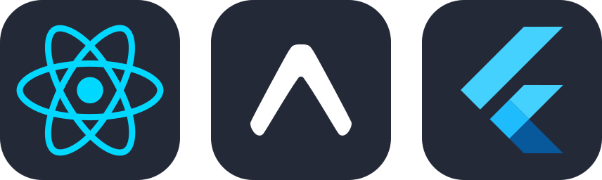
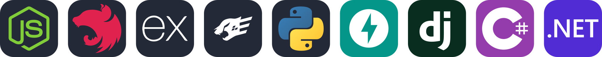
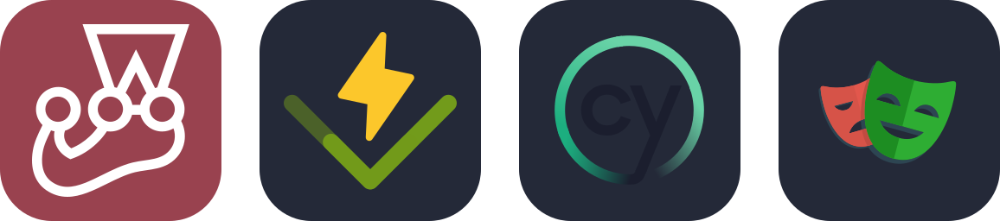
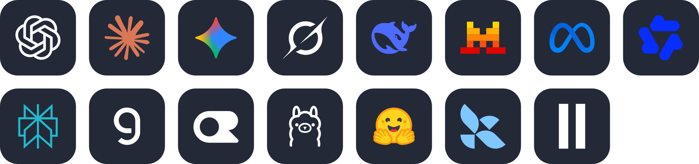

### Hi, I'm Matheus

Senior Full-stack Engineer & Tech Lead based in Campinas, Brazil (UTC-3), working remotely, with near-full overlap with US East Coast hours and 5 to 6 hours with Europe.

I have 6 years of experience building products from scratch and evolving systems in production: marketplaces, internal management systems, B2B portals and AI platforms. I was tech lead at levva and Adalink, and today I work close to product at Pagar, supporting architecture decisions and reviewing the team's code.

### Selected work

- **AI automation platform (Adalink):** built from scratch, as tech lead, a platform where companies create AI assistants integrated with their legacy systems and LLMs. Node.js, NestJS, React, MongoDB.
- **Power transmission settlement (ONS):** end-to-end financial settlement across hundreds of electricity-sector agents, with billing, AI-assisted bank reconciliation and audit trail. Python, FastAPI, React, PostgreSQL.
- **Financial hub for business clients (CAIXA):** AI layer that summarizes a company's financial position and answers questions in natural language. Python, FastAPI, React.
- **Internal trading platform (Grupo NC):** microservices that replaced spreadsheets in a critical, high-volume process. C#, .NET, React.

### Stack

| **Front end** |  |
|:---|:---|
| **Mobile** |  |
| **Back end** |  |
| **Data** |  |
| **Testing** |  |
| **Cloud & DevOps** |  |
| **AI Integration** |  |

Most of my professional work lives in private repositories. Here you'll find API starters in NestJS, Express, Fastify, .NET and Go, plus a React dashboard template.
